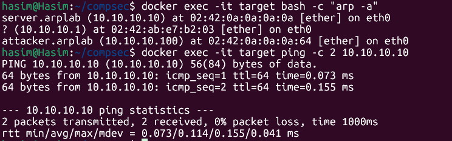
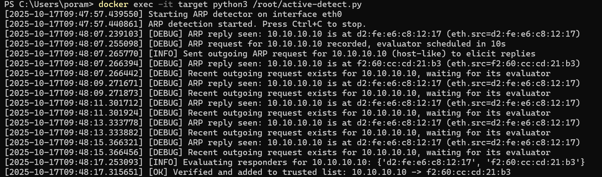
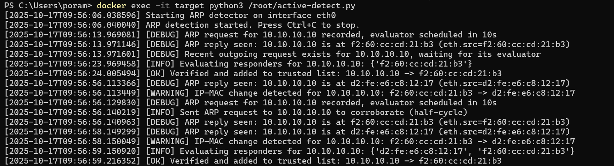

# ARP Spoofing Lab Documentation

## Problem Statement 

This project aims to illustrate an Address Resolution Protocol (ARP) spoofing attack inside a fully controlled Docker network environment. The ARP protocol lacks authentication, which allows a malicious host to fabricate ARP replies and contaminate a victim’s ARP cache. In our setup the attacker continously broadcasts that the server’s IP address corresponds to the attacker’s MAC address. Furthermore, this causes the victim to route traffic to the attacker rather than the legitimate server. The attack is executed using the scapy library at Layer 2 by constructing Ethernet and ARP reply frames and periodically resending them to sustain the poisoning effect. When IP forwarding is disabled, this results in a denial of service, but if it is enabled, it facilitates man-in-the-middle interception and possible session hijacking. The success of the attack is verified by monitoring the victim’s ARP entry change to reflect the attacker’s MAC address and by capturing the redirected traffic on the attacker using tcpdump.

The second goal of the project is to detect an ongoing attack and prevent it from happening. This means in our setup that we correctly identify the attacker's messages as spoofing, give a warning about this to the network admin and set the correct address to the server's MAC. The success of the defense is verified by giving a warning and saving the correct address mapings in a trusted mapping list.


## Lab Objectives

- Poison ARP cache: Show that the victim’s ARP entry for the entry changes to the attacker’s MAC address.
- Intercept/redirect traffic (MITM): With IP forwarding enabled on the attacker, generate traffic from the target to the server and capture it to prove interception.
- Run safely: Use an isolated Docker bridge.
- Develop a mitigation strategy.
- Implement and evaluate a proposed detection framework.

## Security Implications

This lab demonstrates why:
- Public and private WiFi networks are vulnerable to MITM attacks
- ARP spoofing can bypass network segmentation
- Encryption (HTTPS/VPN) is crucial on untrusted networks
- Network monitoring for ARP anomalies is important

## References

- [Docker Networking](https://docs.docker.com/network/)
- [Scapy Documentation](https://scapy.readthedocs.io/)
- [iproute2 Utilities](https://wiki.linuxfoundation.org/networking/iproute2)
- [ARP Protocol RFC 826](https://tools.ietf.org/html/rfc826)
- [Detecting ARP Spoofing: An Active Technique] (https://www.researchgate.net/profile/Sukumar-Nandi-3/publication/221160823_Detecting_ARP_Spoofing_An_Active_Technique/links/0912f50bdc98054c75000000/Detecting-ARP-Spoofing-An-Active-Technique.pdf?origin=publication_detail&_tp=eyJjb250ZXh0Ijp7ImZpcnN0UGFnZSI6InB1YmxpY2F0aW9uIiwicGFnZSI6InB1YmxpY2F0aW9uRG93bmxvYWQiLCJwcmV2aW91c1BhZ2UiOiJwdWJsaWNhdGlvbiJ9fQ)

## Documentation of project

### Attack

The lab consists of three Docker containers connected via a custom bridge network:

| Container | IP Address | MAC Address | Role |
| --- | --- | --- | --- |
| server | 10.10.10.10 | 02:42:0a:0a:0a:0a | Victim |
| target | 10.10.10.50 | 02:42:0a:0a:0a:32 | Target |
| attacker | 10.10.10.100 | 02:42:0a:0a:0a:64 | Attacker |

#### Network Configuration

- Subnet: 10.10.10.0/24
- Network Name: arplab
- Driver: bridge
- No IPv6 support

#### Containers:

- Attacker - 10.10.10.100 (Scapy, tcpdump, ip_forward=1)
- Target - 10.10.10.50 (offer/victim)
- Server - 10.10.10.10 (gateway, generates traffic)

#### How it works

- Poisoning
    - Attacker sends an ARP-reply to the target that says “10.10.10.10 (spoof ip) is on the attackers MAC address.
    - Target updates its ARP-cache to the attackers MAC address.
- Man-in-the-middle
    - When IP-forwarding is activated on the attacker the traffic between the target and the server is sent via the attacker.
    - This is proven with tcpdump on the attacker.
- Restore
    - When the script is canceled, the targets MAC address gets restored to the servers true MAC.

### Defense (Detection)

There are various detection and prevention techniques designed to mitigate ARP spoofing attacks. Several methods have been proposed and implemented, including the following:
    - S-ARP (Secure ARP): A replacement protocol for ARP that enhances security, but requires updating the network stack on all hosts—making it inefficient and costly to deploy.
    - Static ARP entries: Administrators manually configure ARP tables to prevent unauthorized changes. However, this approach is impractical for large-scale networks.
    - Kernel-based patches: These patches attempt to prevent spoofing at the kernel level, but are limited by a race condition between the attacker and the legitimate host. Whichever response arrives first is accepted as the valid ARP entry.
    - Passive detection: This method builds an IP–MAC mapping database by monitoring network traffic and raises an alert when inconsistencies are detected.
Passive detection, while practical, has notable limitations. It introduces a delay between learning legitimate mappings and identifying an attack. If spoofing begins before the detection system establishes the correct mapping, the system may mistakenly record the attacker’s address as legitimate. Consequently, an alarm will only be triggered when the genuine host resumes communication, requiring manual intervention from an administrator to identify the correct MAC address and isolate the attacker.

In this project, we focus on the proposed active detection framework by Vivek Ramachandran and Sukumar Nandi that mitigates several of the previous drawbacks:

Their approach works as follows:

#### Classification of packets

They make the following classification:
1. Inconsistent ARP packets: The MAC addresses in the MAC and ARP header differ. Such packets always belong to spoofing attempts.
2. Consistent ARP packets: where the addresses match. 
Consistent ARP packets are the grouped into:
    - Full ARP Cycle: An ARP request and it’s corresponding ARP replies seen within a specific threshold.
    - Request Half Cycle: An ARP request for which no replies are sent as seen within a specific threshold.
    - Response Half Cycle: An ARP reply generated without an ARP request. 

#### The detection tool

- sniffs all ARP traffic on the network
- classifies the ARP packets into inconsistent and consistent packets
- filters the traffic into already seen and coherent traffic, contradictory traffic from previous traffic (spoofing) and new traffic, which has to be analized
- detects spoofing attacks
- saves legitimate ARP entries in a database or list for future verification

#### The algorithm

How to detetct spoofing on consistent ARP packets:

The detection is based on the following rule:
1. An attacker can impersonate the MAC of a host but he cannot prevent a host from responding to any ARP requests sent to him (if the host is up).
2. A host will accept packets sent to his MAC address, broadcast address and multicast address. Its IP layer will accept these packets if they belong to its IP address and drop the packet otherwise. If the packet is then a TCP-SYN packet, the network layer will respond accordingly, if the packet is accepted.

Based on these rules, we can construct own TCP SYN messages that we send on the network for testing purpose. We build these packets from the information that we get from the collected ARP responses on a host running the detection tool. We construct these packets as follows:
The destination MAC and IP of this packet will be the source MAC and IP of the ARP reply received by the host. The source of this packet will be the MAC and IP of the host running the detection. We will only get a TCP response from the host to whom the address belongs to and no response from any other machine in the network.

This means for the three cases of consistent ARP packets:
- Full ARP cycle: it consists of one request and multiple answers. We construct TCP-SYN packets for all senders of ARP replies. Only the real host will respond with a TCP reply. We identified the correct host and can raise a spoof alarm for the others.

- Request Half Cycle: If source IP of ARP request is not in host databse, we send a TCP-SYN packet to the source IP and MAC of the ARP request. If we get a TCP reply then the host is legitimate, else it is a spoofer. At the same time, we also send a ARP request back to the sender of the request half cycle. If the MACs do not match , we raise a spoof alarm.

- Response Half Cycle: First, we send an ARP request corresponding to the ARP response. We will get one or two ARP replies to this, or none. If we receive at least one reply, we will continue as described in Full ARP cycle and identify the real host and all spoofers. If we get no reply, we can assume that the real host is down and the previous ARP response was a spoofer. To verify, we send a TCP-SYN packet to the host, the reply should have come from and if we do not get a reply, we raise an alarm. 

With this tool we can successfully detect spoofing attacks and even identify the real hosts fast and efficiently. However, this technique sends extra packets over the network, potentially congesting it. 

#### Our implementation

We implemented the algorithm as presented with the following parameters:

- Time window to consider a reply 'on time' after our request (seconds): 10
- Timeout for TCP SYN probe (seconds): 3
- seconds to wait after sending the outgoing request before evaluating: 1

We store the correct IP -> MAC mappings in a list of trusted addresses


## Documentation on testing the project

### Setup

```bash
# Network creation
docker network create --subnet 10.10.10.0/24 arplab

# Creating the containers
docker run -d --name attacker --hostname attacker \
  --network arplab --ip 10.10.10.100 \
  --cap-add=NET_RAW --cap-add=NET_ADMIN \
  --sysctl net.ipv4.ip_forward=1 \
  kalilinux/kali-rolling sleep infinity

docker run -d --name target --hostname target \
  --network arplab --ip 10.10.10.50 \
  --cap-add=NET_RAW --cap-add=NET_ADMIN \
  kalilinux/kali-rolling sleep infinity

docker run -d --name server --hostname server \
  --network arplab --ip 10.10.10.10 \
  --cap-add=NET_RAW --cap-add=NET_ADMIN \
  kalilinux/kali-rolling sleep infinity

# Installing required packages
docker exec -it attacker bash -lc 'apt-get update && apt-get install -y python3-scapy tcpdump iproute2 iputils-ping'
docker exec -it target   bash -lc 'apt-get update && apt-get install -y iputils-ping iproute2 tcpdump curl python3-scapy'
docker exec -it server   bash -lc 'apt-get update && apt-get install -y python3 iproute2'

# A simple HTTP-server on the server
docker exec -d server bash -lc 'cd /tmp && python3 -m http.server 8000'
```

The setup of the docker network should look like this:

```bash
hasim@Hasim:~/compsec$ docker network inspect arplab
[
    {
        "Name": "arplab",
        "Id": "3ac7750f494f81275894d43ecc06c1b7121332a74e9e110c47a85422069fda71",
        "Created": "2025-10-07T13:33:58.317529004+02:00",
        "Scope": "local",
        "Driver": "bridge",
        "EnableIPv6": false,
        "IPAM": {
            "Driver": "default",
            "Options": {},
            "Config": [
                {
                    "Subnet": "10.10.10.0/24"
                }
            ]
        },
        "Internal": false,
        "Attachable": false,
        "Ingress": false,
        "ConfigFrom": {
            "Network": ""
        },
        "ConfigOnly": false,
        "Containers": {
            "03a37c0bf5c2c6ffe576c3436c6e7b00cf35f196176b5b5636e44158bc697b0a": {
                "Name": "target",
                "EndpointID": "8779a17d36479c64ecc4a4f6ae2fa74e8d3a05ecbc58f32e771f87d53369b922",
                "MacAddress": "02:42:0a:0a:0a:32",
                "IPv4Address": "10.10.10.50/24",
                "IPv6Address": ""
            },
            "6aca217428ef61ea4ca41e0c6f465a1b401b37c136f8afcc13dab733f3e2d7fb": {
                "Name": "server",
                "EndpointID": "8871decfb279030b2f4d67881f3ed9b01c1f91344263846454880c09a547fbc2",
                "MacAddress": "02:42:0a:0a:0a:0a",
                "IPv4Address": "10.10.10.10/24",
                "IPv6Address": ""
            },
            "929ecd03ef57272923b83aa1cf22202a547e1d78744f3b875bd2f7f51b849c09": {
                "Name": "attacker",
                "EndpointID": "f040f5a067a19e1fe93eb143d1c1778571591473a11fff48bf7c3db975d004e6",
                "MacAddress": "02:42:0a:0a:0a:64",
                "IPv4Address": "10.10.10.100/24",
                "IPv6Address": ""
            }
        },
        "Options": {},
        "Labels": {}
    }
]
```

### Copy the script

cd to src here first.

```bash
docker cp spoof.py attacker:/root/spoof.py
```

### Before the poisoning

```bash
# On the target - create an ARP entry and display the initial MAC
docker exec -it target bash -lc 'ping -c1 10.10.10.10 || true; ip neigh show 10.10.10.10'
```



This figure shows that the server has read the targets MAC address and that ping works normally before the attack.

### Run the spoofer

```bash
docker exec -it attacker python3 /root/spoof.py 10.10.10.50 10.10.10.10 eth0
# Keep it running until done with testing
```

### Verify poisoning

```bash
docker exec -it target bash -lc 'ping -c1 10.10.10.10 || true; ip neigh show 10.10.10.10'
# The expected is that the lladdr == attackers MAC
```


This photo shows before and after the arp spoofing script is running, the MAC address of the server now has the same MAC address as the attacker. The ping is showing ICMP redirect. The targets arp cache is infected, and the target thinks that the attacker is the server.

### Prove MITM

```bash
# In a terminal, run tcpdump in the attackers network
docker exec -it attacker bash -lc "tcpdump -i eth0 -n host 10.10.10.50"
```

```bash
# In another terminal generate traffic from the target
docker exec -it target bash -lc "curl -s http://10.10.10.10:8000/ | head || ping -c3 10.10.10.10"
# Expected result is that packets in both directions is shown on the attacker (SYN/SYN-ACK/ACK)
```


The first picture is showing a tcpdump  which shows that the attackers MAC is announced for IP 10.10.10.10 which is the poisoning itself. In addition is shows that the target learns the wrong MAC, becuase it has the attackers MAC.

The second picture confirms a MITM attack, the tcpdump on attacker shows full TCP/HTTP flow between 10.10.10.50 ↔ 10.10.10.10

The last picture is extra proof on the attackers logs that a GET request is terminated at the attacker.


## For the active detection:

Ensure that the spoofer is still running so that we have ARP packets inn the network to be captured.

### Copy the script

In another terminal

cd to Defense Lab here first.

```bash
docker cp active-detect(Nversion).py target:/root/active-detect.py
```


### Start the active detetction

```bash
docker exec -it target python3 /root/active-detect.py
# keep it running until done with testing
```

This script runs on the target machine, that receives all the ARP traffic in our setup. The tool monitors all the traffic, detects spoofing attempts and identifies the correct mappings of IP -> MAC.

Here, the attacker's MAC is: d2:fe:e6:c8:12:17
The server's MAC is: f2:60:cc:cd:21:b3




The two picture show how the active detection tool works. For all ARP traffic, the tool analyzes if the captured mapping is correct by sending custom TCP-SYN messages. Due to the high threshold of 10 seconds and the fact the attacker continues sending ARP replies in our setup, we also capture a lot of noise during our evaluation phase from the attacker, to which we do not pay attention here.

The first picture shows the scenario, where the attacker's ARP reply is the first message that we capture after starting the tool. We are here in the Half-Response-Cycle and need to identify the correct mapping for a given ARP reply. We sent an ARP request and collect all replies that we get for this request. Then we send a TCP-SYN packet to all responders and correctly identify the real host for a given IP.

The second picture shows the scenario where the first message that we capture after starting the tool is the ARP request from the target machine and then the corresponding ARP reply. As described in the Full-ARP-Cycle, we send a TCP-SYN message to all senders of replies and identified the correct host which we then added to the list of trusted machines. 


### Restoration

Stop the spoofer with Ctrl+C
Stop the active detection with Ctrl+C

On the target machine:

```bash
docker exec -it target bash -lc 'ip neigh flush all; ping -c1 10.10.10.10 || true; ip neigh show 10.10.10.10'
# Expected is that the MAC address is now restored
```

### Cleanup

```bash
docker rm -f attacker target server
docker network rm arplab
```
